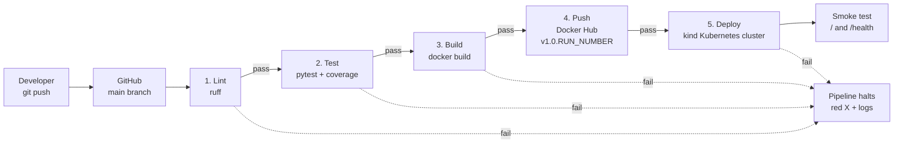
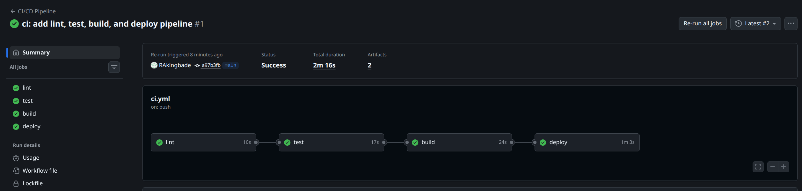
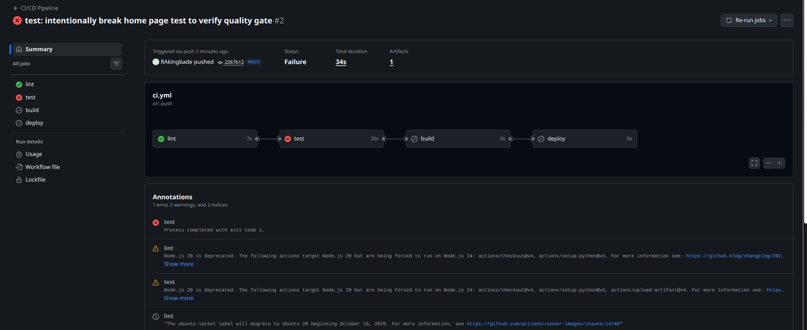
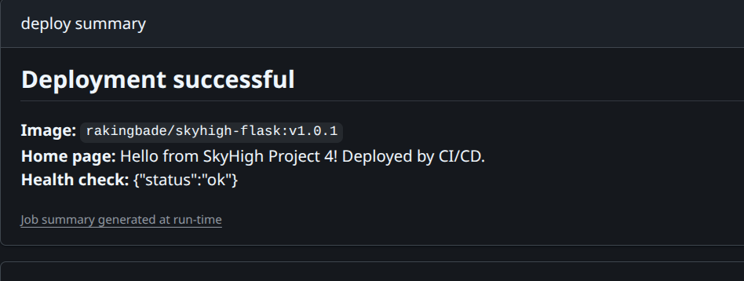
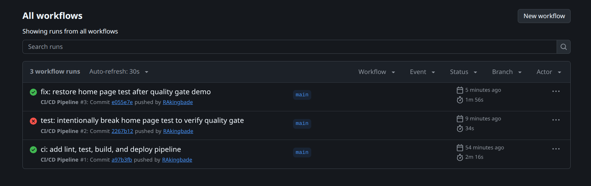

# SkyHigh Portfolio Project 4: Full CI/CD Pipeline

[](https://github.com/RAkingbade/skyhigh-portfolio-project-04/actions/workflows/ci.yml)

## Project Description

A startup's developers were deploying by hand: SSH into the server, pull code, restart the app, and hope nothing broke. This project replaces that with a fully automated CI/CD pipeline built in GitHub Actions.

Every push to `main` is automatically linted, tested, packaged as a versioned Docker image, pushed to Docker Hub, and deployed to Kubernetes, with a smoke test confirming the app is live. Each stage is a quality gate: if any stage fails, nothing after it runs. Code-to-deploy time is about 2 minutes.

## Architecture



## Tech Stack

- **GitHub Actions**: CI/CD orchestration
- **Python 3.12 + Flask**: web application
- **Ruff**: linting
- **Pytest + pytest-cov**: unit tests and coverage reporting
- **Docker + Buildx**: container image build with GitHub Actions layer caching
- **Docker Hub**: container registry
- **Kubernetes (kind)**: deployment target
- **kubectl**: deployment and rollout verification
- **GitHub Actions Secrets**: credential management

## How the Pipeline Works

The workflow lives at `.github/workflows/ci.yml` and runs on every push and pull request to `main`.

| Stage | Job | What it does | Gate |
|---|---|---|---|
| 1 | `lint` | Runs `ruff check .` to catch style and syntax problems | Must pass for tests to run |
| 2 | `test` | Runs pytest with coverage and uploads the results as an artifact for auditing | `needs: lint` |
| 3 + 4 | `build` | Builds the Docker image and pushes it to Docker Hub tagged `v1.0.<run number>` and `latest`. On pull requests it builds but does not push | `needs: test` |
| 5 | `deploy` | Creates a kind Kubernetes cluster, inserts this run's image tag into the manifest, runs `kubectl apply`, waits for the rollout, and smoke tests `/` and `/health` | `needs: build`, main branch pushes only |

**Security**
- Docker Hub credentials are stored as GitHub Actions Secrets (`DOCKER_HUB_USERNAME`, `DOCKER_HUB_TOKEN`) and never appear in code.
- The workflow runs with `permissions: contents: read` (least privilege).
- Deployment only runs on pushes to `main`, never on pull requests.

**Audit trail**
- Every run is logged in the Actions tab with full step-by-step output.
- Test results are saved as a downloadable artifact on every run, including failed ones.
- Every deployed image has a unique version tag tied to its run number.

## Screenshots

### Successful pipeline run


### Quality gate blocking a failed test
A test was intentionally broken to prove the gate works. The test stage failed, and build and deploy were skipped automatically.



### Deployed app running in Kubernetes


### Run history


## Challenges and Solutions

| Challenge | Solution |
|---|---|
| A local Kubernetes cluster can't be reached by GitHub-hosted runners | Used kind to create a disposable Kubernetes cluster inside the runner for each deploy |
| The build failed with "Username and password required" | The Docker Hub secrets weren't set up as repository Actions secrets. Added them with the exact names the workflow expects, then re-ran only the failed jobs |
| Local Python (3.14) didn't match a stable production version | Pinned Python 3.12 in both the workflow and the Dockerfile so every environment matches |
| Git push needs a token that can modify workflow files | Updated the GitHub personal access token to include the `workflow` scope |
| Each deploy needs a unique image version | Left an `IMAGE_PLACEHOLDER` in the manifest and swapped in `v1.0.<run number>` with `sed` at deploy time |

## What I'd Do Differently in Production

- **Persistent cluster**: deploy to a long-lived cluster such as Amazon EKS instead of a temporary kind cluster.
- **Keyless authentication**: use OIDC to authenticate to AWS instead of storing long-lived credentials.
- **Safer rollouts**: use canary or blue/green deployments with Argo Rollouts, plus a one-click rollback workflow.
- **Security scanning**: add Trivy for container images and Bandit for Python code as extra gates.
- **Human approval**: protect `main` with required PR reviews and use GitHub Environments with approval for production.
- **Production server**: run the app with Gunicorn instead of Flask's built-in development server.
- **Maintenance**: keep GitHub Actions versions current (for example, moving off actions that still run on Node.js 20).
- **Notifications**: post pipeline results to Slack.

## Run It Locally

```bash
python3 -m venv venv
source venv/bin/activate
pip install -r requirements-dev.txt
ruff check .
python -m pytest --cov=app --cov-report=term
docker build -t skyhigh-flask .
docker run -p 5000:5000 skyhigh-flask
```
